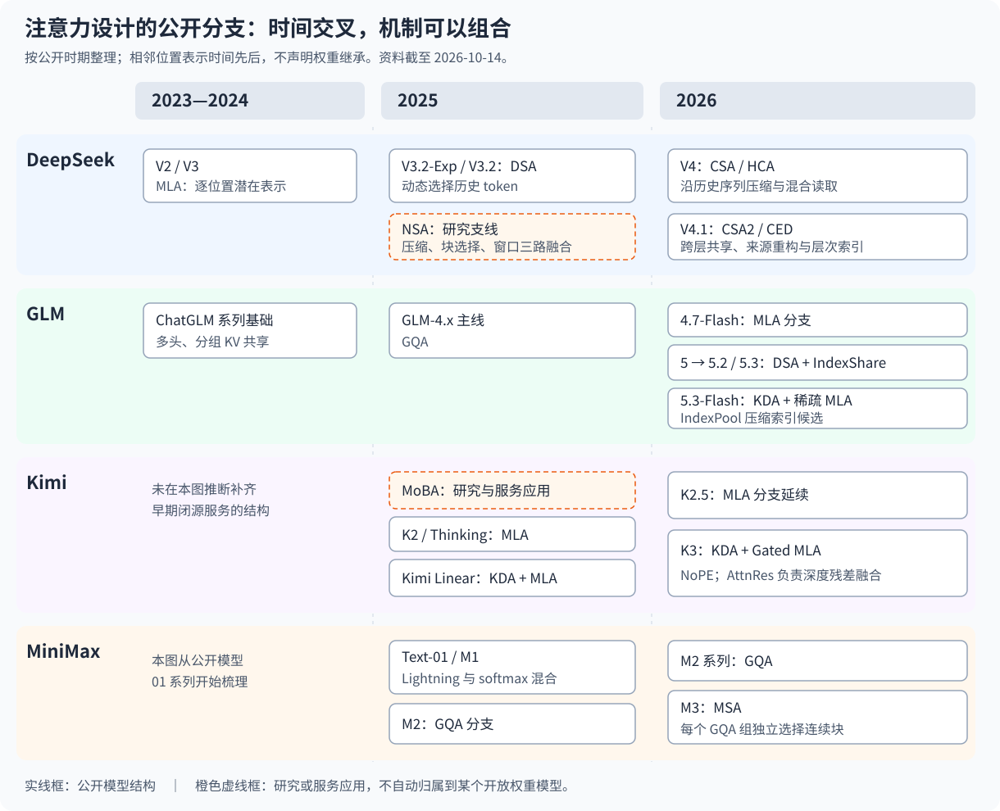

# 注意力机制-17 设计取舍

从 MHA 到 MLA、DSA、CSA2，再到 KDA 混合，注意力演进并不是给同一个公式不断换名字。不同机制分别改变历史的表示、访问范围、写入规则和层间关系。要判断一项设计解决了什么问题，首先要确认它改变了哪一个对象。

本篇收束前面的系列，用统一成本模型和一个可复算的例子比较设计，整理 DeepSeek、GLM、Kimi、MiniMax 的公开分支。资料核对于 **2026-10-14**，范围是模型注意力模块；不把执行内核、分页缓存、卸载与服务调度混作模型架构演进。

## 00 先建立四个坐标，再比较模型名字

考虑长代码上下文中的一次查询。模型既要保留未来可能有用的历史，又要决定当前怎么读取，还要持续接受新增 token。四个问题共同定义了注意力状态：

| 坐标 | 需要回答的问题 | 代表设计 |
|---|---|---|
| 表示 | 一个位置或一组位置保存成什么 | MHA、GQA、MLA、序列压缩 |
| 访问 | 当前 query 读取全部、部分 token，还是块 | DSA、MoBA、MSA、CSA |
| 更新 | 历史是追加、聚合、衰减，还是修正 | 压缩器、Lightning、DeltaNet、KDA |
| 层间关系 | 每层独立，还是共享地址、表示或来源 | IndexShare、CSA2、CED、混合层 |

一个模型可以同时选择这四个坐标。例如 GLM-5.3-Flash 在多数层使用递归状态，在全局层使用 MLA 表示与稀疏读取，再通过 IndexPool 缩短索引候选；不能只将它归为“线性注意力”后就忽略剩余显式历史。

## 01 四家模型的公开分支时间线



图中按公开时期组织已讨论对象，实线框表示公开模型结构，虚线框表示研究方案或服务应用。相邻框的时间先后不表示权重直接继承，也不表示后来者在全部任务上替代此前路线。

### 1.1 DeepSeek：表示、选择、压缩与来源重构

DeepSeek-V2/V3 建立 MLA 路线；V3.2-Exp 在 2025 年引入 DSA，V3.2 继续发展；V4 在 2026 年使用 CSA/HCA，V4.1 再引入 CSA2、CED 与层次化索引。它们分别处理单条表示、访问位置、序列条目数、多层副本、历史来源和重复搜索。

2025 年的 NSA 是时间更早的研究支线：压缩、选择、局部窗口三路注意力经门控组合。它与后来的压缩稀疏方案有共同问题，但公式和粒度不同，不能把它排在 V4.1 之后作为正式后继。[官方发布记录](https://www.deepseek.com/en/news/)、[V2 报告](https://arxiv.org/abs/2405.04434)、[NSA](https://arxiv.org/abs/2502.11089)、[V4.1](https://arxiv.org/abs/2609.19969)。

### 1.2 GLM：主模型与 Flash 分支并行演进

ChatGLM 的多头与分组 KV 结构奠定基础，GLM-4.x 主线使用 GQA；GLM-4.7-Flash 则公开了 MLA 分支。GLM-5 主模型引入 DSA，5.2 原生训练 IndexShare，5.3 主模型沿用 5.2 的基础；5.3-Flash 从新基础模型采用 KDA 与稀疏 MLA 混合。

因此，同为 5.3，主模型与 Flash 的状态和层型并不相同。跨层索引复用、索引池化、线性状态也不是同一个配置开关。[官方系列说明](https://github.com/zai-org/GLM-5)、[4.7-Flash 配置](https://huggingface.co/zai-org/GLM-4.7-Flash/blob/main/config.json)、[Flash 配置](https://huggingface.co/zai-org/GLM-5.3-Flash/blob/main/config.json)。

### 1.3 Kimi：服务研究、MLA 主线与线性混合分支

MoBA 在 2025 年公开研究并报告用于 Kimi 长上下文服务；K2、K2-Thinking、K2.5 的公开模型沿用 MLA 路线。Kimi Linear 于 2025 年后期公开 KDA/MLA 混合，后来的 K3 使用 KDA 与 Gated MLA。

Kimi Linear 与 K2 系列存在时间交叉，不能写成所有产品按编号统一切换注意力。K3 的 AttnRes 作用于深度方向的残差融合，与 token 历史检索是另一个维度。[MoBA 官方仓库](https://github.com/MoonshotAI/MoBA)、[Kimi Linear](https://arxiv.org/abs/2510.26692)、[K3 模型卡](https://huggingface.co/moonshotai/Kimi-K3)。

### 1.4 MiniMax：线性混合与 GQA/块稀疏分支

Text-01/M1 在 2025 年公开 Lightning 线性注意力与 softmax 混合；M2 系列的公开配置使用 GQA，M3 在 2026 年引入 MSA 组级块选择。不能据此宣称 MiniMax 全家族都采用线性注意力，或线性混合被某种稀疏方案全面替代。

不同版本还改变模型规模、训练与任务目标，仅靠注意力名字无法归因全部能力差异。[MiniMax-01](https://arxiv.org/abs/2501.08313)、[M1](https://arxiv.org/abs/2506.13585)、[M2 配置](https://huggingface.co/MiniMaxAI/MiniMax-M2/blob/main/config.json)、[MSA](https://arxiv.org/abs/2606.13392)。

## 02 表示压缩与访问稀疏，各自损失什么

| 方式 | 历史保留形式 | 当前读取 | 主要约束 |
|---|---|---|---|
| MHA/GQA | 每个位置的 K/V | 全部可见位置 | 缓存和匹配随历史增长 |
| MLA | 每个位置的潜在表示 | 可完整读取，也可叠加稀疏 | 低秩结构与位置处理的约束 |
| DSA | 逐位置表示与索引 key | 选择部分 token | 索引可能遗漏相关位置 |
| CSA/HCA | 多 token 聚合条目 | 选择或完整读取摘要 | 聚合阶段已合并细节 |
| MoBA/MSA | 逐 token 主 KV 与块级路由信息 | 选择块后读 token | 块路由误差与无关邻居 |
| KDA | 固定形状关联状态 | 从状态读取 | 干扰、遗忘与有限状态容量 |

主 KV 保留逐 token 地址，意味着未来仍可能重新比较这些位置；若已将多个 token 聚成一条摘要，未来 query 就无法重新决定那些原始 token 之间的独立注意力权重。两者的近似发生在不同阶段。

同样，“未选中”与“未保存”也不同。DSA、MoBA、MSA 通常仍需保留未读历史，因为未来 query 会改变；KDA 则已经把历史合并进状态。固定 Top-K 不等于固定缓存，固定状态也不等于任意历史都能无损检索。

## 03 选择粒度：token、块与摘要不能直接换算

DSA 的 Top-K 是 token 地址；MoBA、MSA 的 Top-K 是块，进入主注意力前展开为块内 token；CSA 的 Top-K 是已经压缩的主条目。GLM IndexPool 则先选索引 pool，再展开回逐 token 主历史。

因此，同样的数值 512 可能代表完全不同的信息预算。CSA 的重叠记录还会覆盖重复来源，不能简单乘压缩率就声称“精确读取了多少个原始 token”。

| 选择入口 | 低成本分数来自哪里 | 何时会遗漏 |
|---|---|---|
| DSA | 独立低维多头索引器 | 辅助分数与主注意力偏好不完全一致 |
| MoBA | query 与主 key 块均值 | 孤立高相关位置被均值稀释 |
| NSA | 压缩注意力概率映射为块分数 | 摘要/块映射未准确代表细读需求 |
| MSA | 每组索引 query，逐 token 打分后块 max | 异常高分带入整块，或低估多项中等证据 |
| IndexPool | 可学习池化的索引 key | 同组细节被聚合，组间排序出现偏差 |

这些选择都需要因果处理：屏蔽未来主 token 还不够，未来信息也不能通过均值、最大值或门控池化影响早期路由。完整组何时可见、当前块是否强制保留、未满尾组怎样处理，都是模型正确性的一部分。

## 04 状态更新：追加、平均、遗忘与修正

采用 $S\in\mathbb R^{d_v\times d_k}$ 的列向量约定，可以把递归路线归纳为：

$$
\begin{aligned}
\text{累加：}\quad&S_t=S_{t-1}+v_tk_t^\top\\
\text{衰减：}\quad&S_t=\lambda_tS_{t-1}+v_tk_t^\top\\
\text{Delta：}\quad&S_t=S_{t-1}+\beta_t(v_t-S_{t-1}k_t)k_t^\top\\
\text{KDA：}\quad&S_t=\bar S_{t-1}+\beta_t(v_t-\bar S_{t-1}k_t)k_t^\top,\quad
\bar S_{t-1}=S_{t-1}D_t
\end{aligned}
$$

$D_t$ 是沿 key 通道的对角遗忘门。基础核注意力还可能维护分母状态 $z_t$；后续输出归一化和门控不能当作这个分母的同义写法。

累加适合累计证据，Delta 更适合修正同方向映射，遗忘便于清理过时内容。三者没有无条件优劣：强遗忘可能丢掉远处关键约束，完全保留又可能增加干扰；定向修正也会影响与当前 key 相关的其他方向。

这些公式提供的是可学习记忆的归纳偏好，不能把一列状态解释为永久绑定的语言变量，也不能仅凭“有遗忘门”证明长期推理一定更强。

## 05 层间共享：共享哪一项，决定省哪一项

| 设计 | 共享对象 | 主要节约 | 继续独立的对象 |
|---|---|---|---|
| IndexCache/IndexShare | 当前 query 的 Top-K 地址 | 重复索引打分与排序 | 各层主 KV、query 与输出 |
| CSA2 Reindex | 主全局 KV 与索引 key | 多层历史副本与写入 | 当前层 query 与重新选择 |
| CSA2 Reuse | 共享历史与最新 Top-K | 状态与选择两部分 | 主 query、局部 KV、输出 |
| CED | 将解码器全局历史来源移到编码器输出 | 提示阶段生成上层全局历史的依赖 | 解码器逐层 query 与局部状态 |
| 线性/全局混合 | 不同层保存不同类型历史 | 降低显式历史层的数量 | 各类型层按自身定义执行 |

共享地址后主注意力概率仍可不同，共享历史后 query 也仍可不同。Full/Reindex/Reuse 的 Full 是职责齐全，不等于读取所有原始 token；混合配置里的 full-attention 层也可能进一步使用稀疏索引。

共享改变了自由度，需要权重适配。只有推理实现能够执行某种模式，并不能证明一个已有 checkpoint 已经学会在该模式下工作。配置覆盖更不能自动创建或训练缺失的模块。

## 06 一个统一容量式：只统计真正存在的历史副本

对单请求，令 $\mathcal F_{KV}$ 为主历史的独立生产者集合，$\mathcal F_I$ 为独立索引历史集合，$\mathcal L_R$ 为递归层集合。忽略取整、元数据和对齐，逻辑容量可写成：

$$
M(T)\approx
\sum_{f\in\mathcal F_{KV}}\frac{T}{m_f}c_fs_f
+\sum_{a\in\mathcal F_I}N_a^I(T)d_a^Is_a^I
+\sum_{l\in\mathcal L_R}H_ld_{k,l}d_{v,l}s_l
+M_{\mathrm{local}}
$$

其中 $m_f$ 是主历史生成步长，$c_f$ 是每条主记录所需的全部元素数，$s_f$ 是每元素字节数。普通 GQA 的 $c_f$ 包含所有组的 K 和 V，MLA 包含潜在表示与确需保存的位置部分；共享 KV 同时充当 K/V 时不能再无条件乘二。

$N_a^I(T)$ 取实际保留的索引记录数。理想池化存储可以按组保留完成记录，但参考实现也可能缓存原始 key 与门控状态再重建 pool，必须据实统计。$M_{\mathrm{local}}$ 包括窗口和短卷积等有界状态。

关键是按独立生产者而非消费者计数：多个层引用同一份全局历史，不应重复算成多份；各层独立局部窗口则仍要各自计算。量化、批量和分布式复制属于另外的乘数，不能省略后再宣称是完整运行显存。

## 07 一个可复算的八层例子

下面构造四种教学设计，统一设 $T=4096$、8 层、每个主历史条目总宽 64、索引 key 宽 16，所有元素均假设为 2 字节。数值是自定义结构的逻辑容量，不对应任何真实模型的质量或速度排名。

| 教学设计 | 主要历史状态 | 逻辑容量 |
|---|---|---:|
| A：8 层独立完整潜在历史 | $8T\times64$ | 4096 KiB |
| B：8 层独立 DSA 类选择 | $8T\times(64+16)$ | 5120 KiB |
| C：2 个共享生产者、8 个消费者，步长 4、每层窗口 32 | $2(T/4)(64+16)+8\times32\times64$ | 352 KiB |
| D：6 个递归层、2 个完整历史层 | $6\times2\times8\times8+2T\times64$ | 1025.5 KiB |

D 的每个递归层假设为 2 头、key/value 各 8 维，不含额外分母和卷积状态。C 组合了序列压缩、表示共享与局部窗口；它的容量更小，并不表示信息保留能力与 A 相同。

```python
T, layers, width, index_dim, byte = 4096, 8, 64, 16, 2
elements = {
    'A': layers * T * width,
    'B': layers * T * (width + index_dim),
    'C': 2 * (T // 4) * (width + index_dim) + layers * 32 * width,
    'D': 6 * 2 * 8 * 8 + 2 * T * width,
}
kib = {name: count * byte / 1024 for name, count in elements.items()}
assert kib == {'A': 4096, 'B': 5120, 'C': 352, 'D': 1025.5}
```

若 B 每层主读取预算为 64，它每个 query 共读 512 个主条目，却仍需扫描 32,768 个低维索引条目；缓存还比 A 多一份索引历史。这个例子直接说明：读取减少、计算减少和缓存减少是三件不同的事。

## 08 一个统一计算式：索引器也要算进去

对一个 query，令 $R_l(T)$ 为第 $l$ 层主读取条目数，$A_l$ 为对应匹配/聚合维度成本；$C_l(T)$ 为索引候选数，$J_l$ 为索引维度成本。主要历史计算可概括为：

$$
F_{\mathrm{query}}(T)\approx
\sum_l A_lR_l(T)+\sum_{l\in\mathrm{index}}J_lC_l(T)
+\sum_{l\in\mathcal L_R}O(H_ld_{k,l}d_{v,l})
$$

这里省略投影、排序、归一化、压缩写入和实现常数。各机制的长度项为：

| 机制 | 主读取规模 | 仍需关注的全局搜索 |
|---|---|---|
| 完整注意力/完整 MLA | $T$ | 主路径已经扫描全历史 |
| DSA | 至多 $K$ | 基础索引器仍扫描 $T$ |
| CSA | 至多 $K+w$ | 扫描约 $T/m$ 条索引记录 |
| HCA | 约 $T/r+w$ | 无索引器，但主路径读取全部摘要 |
| MoBA | 至多 $kb$ | 路由扫描约 $T/b$ 个代表 |
| MSA | 每组至多 $kb$ | 低维索引仍扫描 $T$ 个位置 |
| KDA | 读取固定形状状态 | 无独立的逐历史搜索 |

固定 $K,m,r,b$ 并不意味着表中所有行都严格线性。对所有 query 累加时，任何单 query 的 $O(T)$ 搜索仍可能带来 $O(T^2)$ prefill 项；混合模型还必须加回保留的全局层。

V4.1 层次化索引将后续搜索域限制为固定候选池，首次全范围扫描仍保留。只有实际在候选池内打分，才能获得对应算术节约；完整打分后加 mask 只实现选择语义。

## 09 信息损失从哪里进入，需要怎样的证据

| 变化 | 潜在代价 | 适合检验的任务 |
|---|---|---|
| 潜在或序列压缩 | 表示约束、组内细节合并 | 精确复制、跨组边界检索 |
| token/块选择 | 相关位置被路由遗漏 | 分散多证据、孤立关键事实 |
| 递归累积与遗忘 | 干扰、陈旧关联或过早删除 | 多 key 关联、同 key 更新、长距离保持 |
| 层间共享 | 不同层需求被统一约束 | 需要多阶段关注不同证据的任务 |
| 局部有界回放 | 截断较早层的局部依赖 | 回放边界附近的精确局部判断 |

验证分三层展开。先检查公式与数值：方向、维度、归一化、因果遮罩和状态更新顺序是否一致；再检查实现：来源、选区和计算是否真正按设计执行；最后比较训练后任务质量与目标负载的性能。

数学重排与模型改变也要分清。对既定核注意力交换合法乘法、对同一递归进行正确分块，理论上可以保持模型函数；替换相似度、丢弃候选、共享独立状态或截断回放，则引入新的结构约束或近似，需要训练与实验支持。

## 10 如何阅读下一种注意力设计

面对新论文或 `config.json`，可以按同一顺序追踪：先写出新增 token 产生哪些状态，再列出当前 query 能访问哪些对象，接着确定跨层来源与归一化，最后把主读取、索引搜索和持久容量分别计算。

类名、模型名和参数名只提供入口。`full` 可能描述索引职责或全局层型，`head_dim` 可能属于不同模块，`topk` 可能计 token、块或 pool，`NoPE` 只约束对应路径的显式位置处理。含义必须回到字段消费者与实际公式。

本系列可以按依赖回读：[MHA](/ai-infra/attention-1-mha)、[MQA/GQA](/ai-infra/attention-2-mqa-gqa)建立基础；[MLA](/ai-infra/attention-3-mla)至[V4.1](/ai-infra/attention-7-deepseek-v41)解释 DeepSeek 主线；[NSA](/ai-infra/attention-8-nsa)、[GLM IndexShare](/ai-infra/attention-9-glm-indexshare)、[MoBA](/ai-infra/attention-10-moba)、[MSA](/ai-infra/attention-11-minimax-msa)比较选择与共享；[线性注意力](/ai-infra/attention-12-linear-attention)至[GLM 混合设计](/ai-infra/attention-16-glm-hybrid)解释递归状态及其组合。

这些路线共同说明：长上下文设计需要同时考虑“留下什么、何时写入、怎样找到、哪些层共享”。能力与效率来自这些选择的组合，不能用一个名称或一个压缩倍数替代完整分析。

## 参考资料

以下资料查阅于 2026-10-14；模型配置与代码的 `main` 为滚动分支，复现时应固定 revision。各机制的完整推导与实现入口见对应系列文章。

1. DeepSeek-AI，[V2](https://arxiv.org/abs/2405.04434)、[V3.2](https://arxiv.org/abs/2512.02556)、[V4](https://arxiv.org/abs/2606.19348)、[V4.1](https://arxiv.org/abs/2609.19969)技术报告；[NSA](https://arxiv.org/abs/2502.11089)研究。
2. Z.ai，[GLM-5 系列官方仓库](https://github.com/zai-org/GLM-5)、[GLM-5.3-Flash 发布说明](https://z.ai/blog/glm-5.3-flash)；Bai et al.，[IndexCache](https://arxiv.org/abs/2603.12201)。
3. Moonshot AI，[MoBA](https://arxiv.org/abs/2502.13189)、[Kimi Linear](https://arxiv.org/abs/2510.26692)、[Kimi-K3](https://huggingface.co/moonshotai/Kimi-K3)。
4. MiniMax，[MiniMax-01](https://arxiv.org/abs/2501.08313)、[M1](https://arxiv.org/abs/2506.13585)、[MSA](https://arxiv.org/abs/2606.13392)。
5. Katharopoulos et al.，[Linear Transformers](https://proceedings.mlr.press/v119/katharopoulos20a.html)；Yang et al.，[Gated DeltaNet](https://arxiv.org/abs/2412.06464)。
