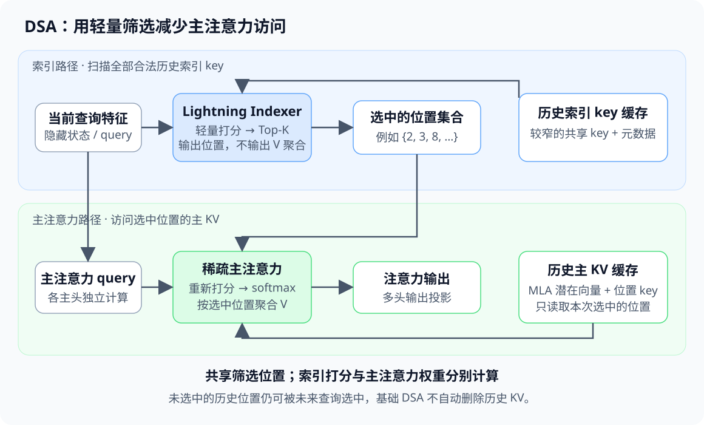

# 注意力机制-4 DSA

一份代码仓库、几百轮工具调用和持续增长的执行日志，会让 Agent 的上下文不断变长。[上一篇 MLA](/ai-infra/attention-3-mla)解释了如何压缩每个历史位置的 K/V 表示，但每次查询仍需要遍历历史位置。上下文从数千 token 增长到数十万 token 后，表示压缩之外，还需要减少主注意力实际参与计算的位置。

DSA（DeepSeek Sparse Attention，DeepSeek 稀疏注意力）为此引入一个可训练的轻量索引器：先筛选重要历史位置，再在筛选结果上计算主注意力。本文从这一计算链出发，解释它与 MLA 的组合、训练方式和系统成本，随后讨论跨层索引复用，以及 `--hf-overrides '{"index_topk_freq":8}'` 究竟改变了什么。

> 本文以 DeepSeek-V3.2 的 DSA 为原理基准，以 GLM-5.3 和 vLLM 的实现连接部署实践。资料核对日期为 **2026-10-14**；源码中的 `main` 链接属于滚动分支，实际部署需记录具体版本与后端。数值案例是推导或论文结果，文中未进行模型服务实测。

## 00 MLA 之后，长上下文还剩下什么问题

设当前查询位于 $t$，允许访问的位置为 $0\le j\le t$。对第 $i$ 个注意力头，普通因果注意力计算：

$$
S_{t,j,i}=\frac{q_{t,i}^{\top}k_{j,i}}{\sqrt{d_k}},\qquad
P_{t,j,i}=\operatorname{softmax}_{j\le t}(S_{t,j,i})
$$

$$
o_{t,i}=\sum_{j=0}^{t}P_{t,j,i}v_{j,i}
$$

$S$ 是匹配打分，$P$ 是注意力概率。MLA 可以把历史 K/V 表示为低维潜在向量，并通过矩阵吸收直接在潜在空间中计算，但上式仍然需要考虑每个合法位置。

设完整序列长 $T$。Prefill（预填充）一次处理整段输入，因果位置配对数量是：

$$
\sum_{t=0}^{T-1}(t+1)=\frac{T(T+1)}{2}
$$

Decode（解码）每次处理一个新查询，它需要访问约 $T$ 个历史位置。批量、头数和维度固定时，前者的位置配对是 $O(T^2)$，后者单步是 $O(T)$。

MQA/GQA 减少 KV 头数，MLA 压缩 KV 表示；DSA 则进一步选择**哪些位置进入主注意力**。三者优化的对象不同，不能把它们当成几个可以任意叠加的独立压缩开关。

DSA 首次以主流公开模型的形式出现在 **2025-09-29 发布的 DeepSeek-V3.2-Exp**，随后进入 V3.2 正式版。更早的 NSA（Native Sparse Attention，原生稀疏注意力）研究采用压缩、选择和滑动窗口等组合设计，与本文讨论的 DSA 并非同一套具体机制。[V3.2-Exp 官方公告](https://deepseek.com/news/v3-2-exp/)、[NSA 原论文](https://arxiv.org/abs/2502.11089)分别给出了两条路线的来源。

## 01 两条计算路径：先筛选，再聚合

DSA 将一次注意力拆成两个职责明确的过程：

1. **Lightning Indexer（轻量索引器）**读取当前查询特征和历史索引 key，给每个候选位置打分，输出 Top-K 位置集合。
2. **主注意力**读取这些位置对应的 K/V，使用自身的多头打分、softmax 和 value 聚合产生输出。



图中有两份不同用途的历史状态。索引器的 key 用于判断位置是否值得访问；主注意力的 K/V 用于真正提取内容。索引 key 不是主注意力 key 的别名，Top-K 索引也不是注意力概率。

先建立后文的记号：

| 符号 | 含义 |
|---|---|
| $T$、$L$ | 序列长度、Transformer 主干层数 |
| $t$、$j$、$\ell$ | 当前查询位置、候选历史位置、层号，均从 0 开始 |
| $H$、$H_I$ | 主注意力头数、索引器头数 |
| $d_I$ | 每个索引头的维度 |
| $K$ | 每个查询最多选取的历史位置数 |
| $I_{t,j}$ | 索引器对历史位置 $j$ 的打分 |
| $\mathcal S_t$ | 查询 $t$ 最终选择的位置集合 |
| $c_j^{KV}$ | MLA 的历史 K/V 潜在向量 |

下面先省略层号、批量和并行切分。一个查询的概念流程可以写成：

```python
# 教学伪代码：定义因果语义，不对应生产内核的数据布局
valid_positions = range(t + 1)
index_scores = indexer(query_features, index_keys[valid_positions])
selected = topk(index_scores, k=min(K, t + 1)).indices

q = main_query(query_features)
selected_kv = main_kv_cache.gather(selected)
output = main_attention(q, selected_kv)
```

这里先限定合法位置，再做 Top-K。批量 prefill 可以用因果掩码实现相同语义；若张量中混入未来位置、其他请求的位置或无效填充，Top-K 数量正确也不能保证计算正确。

这一“索引选择 → 稀疏主注意力”的分工来自 [DeepSeek-V3.2 技术报告 §2.1](https://arxiv.org/html/2512.02556v1#S2.SS1)，具体投影和缓存可对照[官方 `Indexer` 实现](https://github.com/deepseek-ai/DeepSeek-V3.2-Exp/blob/main/inference/model.py)。

## 02 Lightning Indexer 如何给历史位置打分

### 2.1 多个查询头，共享一份索引 key

索引器为当前 token 生成 $H_I$ 个查询向量 $q^I_{t,a}\in\mathbb R^{d_I}$，为每个历史 token 保存一个共享的 $k^I_j\in\mathbb R^{d_I}$，并生成与当前查询有关的标量权重 $w^I_{t,a}$。

论文中的核心打分为：

$$
I_{t,j}=\sum_{a=1}^{H_I}w^I_{t,a}
\operatorname{ReLU}\!\left((q^I_{t,a})^{\top}k^I_j\right)
$$

下标 $a$ 表示索引头，与主注意力的头编号 $i$ 区分。每个索引头可以从不同特征角度评价历史位置，最后汇总成**一个位置分数**。所有主注意力头随后共用同一个候选集合，而非每个主注意力头独立检索一组位置。

ReLU 在点积之后执行，负匹配被截为零；它本身不意味着最终 $I_{t,j}$ 一定非负，因为 $w^I_{t,a}$ 是学习得到的权重，不能默认它已经经过 softmax 或限制为正数。排序只要求候选分数可比较，不要求它们构成概率分布。

### 2.2 为什么比直接运行主注意力便宜

DeepSeek-V3.2-Exp 的[官方配置](https://huggingface.co/deepseek-ai/DeepSeek-V3.2-Exp/blob/main/config.json)包含：

```json
{
  "index_n_heads": 64,
  "index_head_dim": 128,
  "index_topk": 2048,
  "kv_lora_rank": 512,
  "qk_rope_head_dim": 64
}
```

索引器只生成用于筛选的分数，不执行主注意力的全部多头 value 聚合。它还使用较窄的共享 key，并可采用 FP8 打分。这些设计降低了常数成本；“轻量”描述的是这组计算和实现特征，不表示索引器不再扫描历史。

在[官方参考代码](https://github.com/deepseek-ai/DeepSeek-V3.2-Exp/blob/main/inference/model.py)中，索引 query 从主 query 的低秩中间表示继续投影，索引 key 则由当前隐藏状态独立生成，并经过 LayerNorm。代码还包含部分维度的 RoPE（Rotary Position Embedding，旋转位置编码）、Hadamard 旋转、量化和缩放处理。

这些步骤有各自作用：RoPE 引入位置信息；在精确算术下，同一个正交变换满足 $(Rq)^\top(Rk)=q^\top k$；低精度计算中的旋转与缩放则服务于数值表示。理解核心排序公式后，再沿代码检查这些步骤，才能区分模型语义与数值实现。

### 2.3 一个可以手算的筛选例子

考虑两个索引头、四个合法位置。设两头的点积、权重和结果如下；这只是解释公式的示意数据：

| 历史位置 $j$ | 头 1 点积 | 头 2 点积 | $w_1=1,w_2=0.5$ 时的 $I_{t,j}$ |
|---|---:|---:|---:|
| 0 | 2 | -1 | $2+0.5\times0=2$ |
| 1 | -1 | 4 | $0+0.5\times4=2$ |
| 2 | 3 | 2 | $3+0.5\times2=4$ |
| 3 | 0 | 6 | $0+0.5\times6=3$ |

若 $K=2$，选中位置为 $\{2,3\}$。主注意力随后重新计算这两个位置的多头匹配分数；它完全可能更偏好位置 3。索引分数决定是否入选，主注意力分数决定入选后如何分配权重。

## 03 Top-K 之后，MLA 如何完成注意力

### 3.1 位置集合与注意力概率分开计算

令合法候选集合为 $\mathcal C_t=\{0,\ldots,t\}$，则：

$$
\mathcal S_t=\operatorname{TopKPositions}_{j\in\mathcal C_t}
\left(I_{t,j},\min(K,t+1)\right)
$$

沿用 MLA 的潜在空间写法，$\widetilde q_{t,i}\in\mathbb R^{d_c}$ 是吸收内容 K 上投影后的 query，$q^R_{t,i}$、$k^R_j$ 是位置分支。主注意力打分为：

$$
S_{t,j,i}=\alpha\left(
\widetilde q_{t,i}^{\top}c_j^{KV}
+q_{t,i}^{R\top}k_j^R
\right),\qquad j\in\mathcal S_t
$$

$\alpha$ 表示模型规定的缩放系数，可能包含长上下文位置缩放。只在入选集合上归一化：

$$
P_{t,j,i}=
\frac{\exp(S_{t,j,i})}{\sum_{r\in\mathcal S_t}\exp(S_{t,r,i})}
$$

然后在潜在空间中聚合，再执行 value 上投影：

$$
z_{t,i}=\sum_{j\in\mathcal S_t}P_{t,j,i}c_j^{KV},\qquad
o_{t,i}=W_i^{UV}z_{t,i}
$$

这些式子将上一篇的 MLA 计算域从完整历史替换为 $\mathcal S_t$。各头仍有不同的主 query、注意力分布和输出映射，共享的是位置集合及可复用的历史潜在表示。

### 3.2 稀疏化带来的误差来自哪里

DSA 不等价于先算完稠密注意力，再把很小的概率删掉。索引器使用另一组参数做预筛选，可能漏掉某个主注意力头需要的位置；softmax 的分母也随集合变化。

假设先用稠密注意力得到概率 $P_j$，筛选集合覆盖的概率质量为 $1-\varepsilon$，其中：

$$
\varepsilon=\sum_{j\notin\mathcal S}P_j
$$

若**保持入选位置的主注意力 logits 不变**，稀疏 softmax 就是把集合内概率重新归一化。记集合内外的条件 value 均值为 $\mu_{\mathrm{in}}$、$\mu_{\mathrm{out}}$，有：

$$
o_{\mathrm{dense}}=(1-\varepsilon)\mu_{\mathrm{in}}
+\varepsilon\mu_{\mathrm{out}},\qquad
o_{\mathrm{sparse}}=\mu_{\mathrm{in}}
$$

$$
o_{\mathrm{dense}}-o_{\mathrm{sparse}}
=\varepsilon(\mu_{\mathrm{out}}-\mu_{\mathrm{in}})
$$

这给出一个局部分析：遗漏的概率质量越小，且集合内外 value 差异越小，当前头的输出差异通常越小。它不是全模型误差保证，因为多层计算会改变后续隐藏状态，实际 DSA 模型也经过了训练适配。

### 3.3 索引选择不等于永久 KV 淘汰

当前查询没有选中位置 100，不意味着未来查询也不需要它。Top-K 随当前隐藏状态、位置和层发生变化，下一次查询可能再次选中这个位置。

因此，基础 DSA 中主 KV 和索引 key 通常仍随上下文保留。它降低主注意力每次访问的范围，不自动把持久缓存容量从 $O(T)$ 变成 $O(K)$。

若要进一步减少 GPU 常驻容量，需要另行设计分页、分层存储、预取或卸载，并保证被选中的 KV 在计算前可用。[《KVCache卸载：LMCache》](/ai-infra/kv-cache-offload-1-lmcache)讨论的是这些缓存管理问题。稀疏访问与缓存卸载可以结合，但二者需要接口和时序上的配合。

## 04 离散选择如何获得训练信号

Top-K 输出的是离散位置。普通反向传播不能直接通过“是否入选”这个离散决定，为所有候选位置提供连续梯度。DeepSeek-V3.2 使用主注意力的分布监督索引器，并分阶段让主模型适应稀疏计算。

### 4.1 先用稠密注意力教索引器筛选

在 dense warm-up（稠密预热）阶段，主模型保持稠密注意力并冻结参数，只训练索引器。将各主注意力头的概率汇总并沿位置归一化，得到目标分布 $p_{t,j}$。若每个头的 $P_{t,j,i}$ 都已归一化，可写成：

$$
p_{t,j}=\frac{1}{H}\sum_{i=1}^{H}P_{t,j,i}
$$

索引器分布记为 $r_{t,:}=\operatorname{softmax}(I_{t,:})$，使用 KL 散度：

$$
\mathcal L_I=\sum_tD_{\mathrm{KL}}(p_{t,:}\Vert r_{t,:})
$$

训练时的 softmax 是为了构造可监督的分布；推理筛选只需要 Top-K 排序。对固定合法集合，softmax 保持大小顺序，因此不必为得到相同 Top-K 而额外归一化。

### 4.2 再让模型适应筛选后的输入

在 sparse training（稀疏训练）阶段，主模型启用 Top-K 位置选择，通过语言建模损失学习在稀疏上下文中完成任务；索引器继续接受注意力分布监督，监督范围转为选中集合，并在该集合上归一化。

报告明确将索引器输入与主模型计算图分离：主模型由语言建模损失优化，索引器由索引监督损失优化。这样无需假设语言建模梯度能够穿过离散 Top-K 完整传播。[DeepSeek-V3.2 报告 §2.1.1](https://arxiv.org/html/2512.02556v1#S2.SS1.SSS1)给出了两阶段训练与梯度分工。

这也解释了使用前提：DSA 包含学到的索引器和适应稀疏模式的模型参数。给普通全注意力模型添加 `index_topk` 字段，不会自动生成对应能力。

## 05 主注意力减少了多少，索引器还要做多少

### 5.1 先分开 Prefill 和单步 Decode

仅比较与历史长度相关的匹配和聚合，暂不计投影、归一化与前馈网络。令 $a$、$b$ 分别概括一次主注意力位置配对、一次索引配对的成本；$K$ 固定，且 $T\gg K$：

| 计算部分 | Prefill 整段 | Decode 单步 |
|---|---|---|
| 稠密主注意力 | 约 $aT^2/2$ | 约 $aT$ |
| DSA 主注意力 | 约 $aTK$ | 约 $aK$ |
| 原始 DSA 索引打分 | 约 $bT^2/2$ | 约 $bT$ |

Top-K 归约、缓存写入和不规则读取还有额外成本，未并入表中的配对估算。不同 kernel 的 $a$、$b$ 也会随形状和硬件变化。

所以，**主注意力可以从二次配对降为近似 $TK$，原始索引器仍具有二次长度依赖**。单步 decode 同样保留索引扫描的线性项。把完整 DSA 称为严格线性注意力，会遗漏这一部分成本；这一边界也见 [DeepSeek-V3.2 报告 §2.3](https://arxiv.org/html/2512.02556v1#S2.SS3)。

### 5.2 为什么 Prefill 不能直接套用 $T/K$

对第 $t$ 个查询，最多有 $\min(K,t+1)$ 个合法位置进入主注意力。因此，当 $T\ge K$，精确的位置配对数为：

$$
N_{\mathrm{sparse}}
=\sum_{t=0}^{T-1}\min(K,t+1)
=KT-\frac{K(K-1)}{2}
$$

取 $T=131072$、$K=2048$，只比较主注意力位置配对：

| 项目 | 数值 |
|---|---:|
| 稠密因果配对 | $8\,590\,000\,128$ |
| 稀疏因果配对 | $266\,339\,328$ |
| 配对数量之比 | 约 $32.25$ 倍 |
| 序列末端单次查询的位置数之比 $T/K$ | $64$ 倍 |

二者分母不同：整段 prefill 中，稠密查询平均只看约半段历史；序列末端的一个 query 才面对完整长度。**两项数字都不是端到端加速比**，因为还没有计入索引器和其他模型计算。

### 5.3 从计算量到真实耗时，还隔着内存访问

索引器扫描历史 key 的访问较规则，主注意力访问 Top-K 位置则可能分散。后者会遇到 HBM（High Bandwidth Memory，高带宽显存）访问合并、分页地址转换和 kernel 启动开销。

设一次前向的实际耗时拆成：

$$
\tau=\tau_{\mathrm{index}}+\tau_{\mathrm{attn}}
+\tau_{\mathrm{other}}
$$

其中 other 包含投影、前馈、通信等成本。即使主注意力位置数减少很多，整体收益仍取决于三个部分的占比。短上下文下，索引和选择的固定成本还可能抵消稀疏访问收益。

## 06 缓存布局与内核：语义正确，还需要执行正确

### 6.1 索引器也要保存历史状态

MLA 保存主潜在向量及位置 key；索引器还需要自己的历史 key 和量化元数据。以下只估算单 token、单层的逻辑缓存，不计分页填充、复制、工作空间和分配器开销：

| 假设布局 | 字节数 |
|---|---:|
| 主潜在向量 512 维与位置 key 64 维，均 BF16 | $(512+64)\times2=1152$ |
| 索引 key 128 维，FP8 | $128$ |
| 每 128 个索引元素一份 FP32 scale | $4$ |
| 两部分合计 | $1284$ |

这个混合精度示意布局比单独的 BF16 MLA 主缓存多约 $11.46\%$。它说明稀疏计算可以引入辅助状态；不是声称生产环境必须采用该布局。官方参考实现的索引缓存确有 FP8 key 与 scale，主缓存还模拟了量化精度；其他后端可能使用不同的主 KV 精度与打包方式。[参考实现中的缓存定义](https://github.com/deepseek-ai/DeepSeek-V3.2-Exp/blob/main/inference/model.py)可用于核对这些区别。

索引器有 64 个 query 头，不代表需要缓存 64 份索引 key；前面的共享 key 设计正是这里的容量依据。

### 6.2 用稠密掩码表达稀疏，不保证少做计算

官方简化参考实现先形成主注意力分数，再通过 Top-K 产生的掩码将未选中位置设为负无穷。这能清楚表达“softmax 只能看到所选位置”的语义，但若仍然完整计算了分数矩阵，就不能据此宣称执行成本已降为 $O(TK)$。

生产稀疏内核应将索引传入后端，让实际匹配和聚合跳过未选中的主 KV，而不是只在完整结果上加掩码。与此对应，[Transformers 的 V3.2 实现](https://github.com/huggingface/transformers/blob/main/src/transformers/models/deepseek_v32/modeling_deepseek_v32.py)区分了掩码路径与向后端传递稀疏位置的路径；[vLLM 的 V3.2 注意力实现](https://github.com/vllm-project/vllm/blob/main/vllm/models/deepseek_v32/attention.py)则把索引器、共享位置缓冲区与稀疏后端连接起来。

因此，读源码时至少要沿两条线追踪：位置集合如何生成，以及后端是否真的利用它减少主注意力访问。数学上的稀疏性与执行层面的加速需要分别确认。

## 07 IndexCache：为什么后续层可以复用位置集合

DSA 减少了昂贵的主注意力配对后，逐层运行的索引器可能成为新的主要开销。IndexCache 利用相邻层选择结果的相关性，把层分为两类：

- **Full 层（F）**运行自己的索引器，更新位置集合。
- **Shared 层（S）**复用最近一个 F 层的集合，继续执行自己的主注意力。

```text
逐层索引： F F F F | F F F F
四层复用： F S S S | F S S S
八层复用： F S S S S S S S | F ...
```

这里的 Full 表示完整运行索引器，**不是恢复稠密主注意力**。复用发生在同一次前向的不同层之间，也不意味着跨请求共享 KV 或跳过后续层的注意力。

对第 $\ell$ 层，主聚合仍然使用该层自己的表示：

$$
o^{(\ell)}_{t,i}
=\operatorname{Attn}^{(\ell)}_i
\left(q^{(\ell)}_{t,i},
\{KV^{(\ell)}_j:j\in\mathcal S^{(a)}_t\}\right)
$$

$a\le\ell$ 是为它提供位置集合的 F 层。共享位置不要求各层 KV 向量相同，但要求这些位置能正确映射到各层的合法 KV。

### 7.1 可以不重新训练，但保留哪些层很重要

[IndexCache 项目](https://github.com/THUDM/IndexCache)给出两种适配方式：不更新权重时，在校准数据上按语言建模损失搜索 F/S 安排；可以训练时，则让保留的索引器同时学习服务多个层。

后者可以理解为：假设一个索引器服务 $m$ 个层，各层目标分布是 $p^{(1)},\ldots,p^{(m)}$，则学习一个兼顾这些层的分布 $r$。平均目标为：

$$
\bar p=\frac1m\sum_{u=1}^{m}p^{(u)}
$$

当目标分布在索引器更新中视为常量时，对 $r$ 的参数求导，平均 KL 损失与 $D_{\mathrm{KL}}(\bar p\Vert r)$ 具有相同梯度。它表达的是“学习多个层共同需要的位置”，不能由“某层的位置与下一层相似”自动替代。

### 7.2 论文中的八层复用并非普遍无损

在 [IndexCache 论文表 2](https://arxiv.org/html/2603.12201v1#S4.T2)的 **30B DSA 模型、免训练设置**中，长上下文综合分数如下。保留比例指索引器数量占原始逐层索引器的比例：

| 配置 | 长上下文综合分数 |
|---|---:|
| 原始 DSA | 50.2 |
| 保留 1/4，均匀安排 | 43.0 |
| 保留 1/4，搜索安排 | 49.9 |
| 保留 1/8，均匀安排 | 35.3 |
| 保留 1/8，搜索安排 | 46.1 |

这些结果支持的判断是：复用安排和训练适配会影响质量，过度移除索引器可能损害长上下文能力。它们既不是 GLM-5.3 的实测结果，也不能直接预测某个业务的下降幅度。

若一个均匀分组有 $f$ 层，并且共享层完全省去对应索引打分，忽略开头保留层等例外，可估算索引开销降为原来的 $1/f$。设索引器原占总耗时比例 $\rho$，其他成本不变，则理想化整体加速比为：

$$
\operatorname{Speedup}(f)
\approx\frac1{(1-\rho)+\rho/f}
$$

例如 $\rho=0.4$、$f=8$ 时，结果约为 $1.54$，并非 8 倍。这是按比例拆分的分析模型，实际值还取决于 kernel、缓存、通信和并行调度。

## 08 从模型配置读懂 GLM 与 DeepSeek 的关系

### 8.1 架构类名不等于模型身份

GLM-5.3 的 `config.json` 声明 `GlmMoeDsaForCausalLM`，含义是加载对应的 GLM、MoE 与 DSA 因果语言模型实现。它描述软件如何构建网络；权重仍来自 GLM-5.3。

vLLM 的[`deepseek_v32` 平台入口](https://github.com/vllm-project/vllm/blob/main/vllm/models/deepseek_v32/__init__.py)让 GLM 的 DSA 模型复用兼容的推理模块。因此，在 GLM 的执行栈中看到 `deepseek_v32`，反映的是共享算子和模型实现路径，不能据此把 GLM 权重认作 DeepSeek 权重。

截至本文查阅日期，官方资料可以确认的代表包括：

| 模型或家族 | 与 DSA 的关系 |
|---|---|
| DeepSeek-V3.2-Exp、V3.2、Speciale | 原始 Lightning Indexer + token 级稀疏选择路线。[正式版公告](https://deepseek.com/news/deepseek-v3-2/) |
| GLM-5、5.1、5.2、5.3 | GLM 采用 DSA；5.2 引入四层 IndexShare，5.3 沿用 5.2 的基础模型。[官方仓库](https://github.com/zai-org/GLM-5) |
| GLM-5.3-Flash | 线性注意力与 MLA/DSA 层混合，需按其独立实现分析。[架构文档](https://huggingface.co/docs/transformers/v5.19.0/model_doc/glm5_next) |
| 腾讯 Hy4-preview | Gated DSA，结合门控与跨层索引复用。[官方模型卡](https://huggingface.co/tencent/Hy4-preview) |
| 快手 Keye-VL-2.0 | 将 DSA 扩展到 GQA 多模态架构，说明 DSA 的选择思想并不以 MLA 为唯一载体。[技术报告](https://arxiv.org/abs/2606.10651) |
| DeepSeek-V4 / V4.1、LongCat | 进一步发展为结合压缩或层次化索引的 CSA、CSA2、LSA，应与原始 DSA 实现区分。[V4 公告](https://deepseek.com/news/v4-preview/)、[V4.1 模型卡](https://huggingface.co/deepseek-ai/DeepSeek-V4.1-Flash)、[LongCat-2.0 模型卡](https://huggingface.co/meituan-longcat/LongCat-2.0) |

这个表用于说明技术扩展范围，不是参数兼容表。稀疏注意力存在多条路线，同样具有 Top-K，也可能选择不同单位、使用不同地址布局和复用规则。

### 8.2 `hf-overrides` 是配置覆盖入口

vLLM 的 `--hf-overrides` 接收 JSON 配置覆盖项。例如：

```bash
--hf-overrides '{"index_topk_freq":8}'
```

它在加载过程中设置配置字段；最终是否改变计算，取决于被选中的模型实现是否读取这个字段。它不会自动补齐索引器权重、改写不支持的注意力后端，或为任意模型增加 DSA。

同一个机制在 SGLang 通常通过 `--json-model-override-args` 传入，不能把两个框架的命令行参数名混用。[IndexCache 的启动说明](https://github.com/THUDM/IndexCache)同时给出了两种入口。

### 8.3 GLM-5.3 的 `4 → 8` 具体跳过哪些层

[官方配置](https://huggingface.co/zai-org/GLM-5.3/blob/main/config.json)包含以下字段：

```json
{
  "index_topk": 2048,
  "index_topk_freq": 4,
  "index_skip_topk_offset": 3,
  "index_topk_pattern": null
}
```

本文核对的 vLLM V3.2 路径，在没有显式 pattern 时，按下面的规则决定是否复用。以下省略 MTP（Multi-Token Prediction，多 token 预测）等特殊层：

```python
# 与该实现主干层规则对应的最小逻辑，layer_id 从 0 开始
skip_topk = max(layer_id - offset + 1, 0) % freq != 0
```

代入 `offset=3`，78 层主干的索引安排为：

| 配置 | 重新计算位置集合的层 | F 层数量 |
|---|---|---:|
| `freq=4` | `0, 1, 2, 6, 10, 14, …, 74` | 21 |
| `freq=8` | `0, 1, 2, 10, 18, 26, …, 74` | 12 |

这里由 21 个 F 层减少到 12 个，主干索引器数量减少约 $42.86\%$，并非严格减半，因为开头保留层不受常规分组比例支配。

`index_topk` 仍是 2048；变化的是重新选择位置的层间隔。新的 F 层是原有 F 层的子集，适合继续使用这些层已有的索引器权重，但更长的共享范围仍需验证质量。规则和索引器构建可对照 [vLLM `attention.py`](https://github.com/vllm-project/vllm/blob/main/vllm/models/deepseek_v32/attention.py)。

### 8.4 同一个字段，不同实现可能有不同优先级

在当前核对的 vLLM V3.2 路径中，非空的 `index_topk_pattern` 优先于 `index_topk_freq`。Hy4 的实现则先读取逐层 `indexer_types`，只有没有该列表时才回退到频率。[Hy4 的判断逻辑](https://github.com/vllm-project/vllm/blob/main/vllm/models/hy_v4/nvidia/attention.py)直接体现了这个差别。

此外，[vLLM IndexCache 文档](https://github.com/vllm-project/vllm/blob/main/docs/features/index_cache.md)要求 `use_index_cache:true`，而本文核对的 V3.2 新路径直接按频率安排索引器。文档、版本和平台路径可能处于不同演进阶段，不能只看一份示例推断所有安装版本。

按已核对源码，可将使用范围概括为：

| 执行路径 | 对 `index_topk_freq` 的判断 |
|---|---|
| V3.2、GLM-5～5.3 的 vLLM DSA 路径 | 有明确的频率读取与跨层复用逻辑；仍需检查 pattern、权重和后端 |
| Hy4 | 先检查 `indexer_types`，单独覆盖频率可能无效 |
| DeepSeek-V4 的 vLLM-Ascend 路径 | 有专门实现，需开启 `use_index_cache`，并按 C4 索引层序号计算间隔 |
| GLM-5.3-Flash、V4.1 等独立路径 | 不能因同属稀疏注意力就套用，需分别追踪参数读取与执行逻辑 |

后两项可分别查看 [Ascend 的 V4 索引复用函数](https://github.com/vllm-project/vllm-ascend/blob/main/vllm_ascend/utils.py)与 [GLM-5.3-Flash 的注意力实现](https://github.com/vllm-project/vllm/blob/main/vllm/models/glm5next/common/attention.py)。这是开发分支的实现核对，不代表所有发布包均已具备相同行为。

## 09 使用八层复用之前，需要满足哪些条件

从前面的数据流，可以归纳出四项结构与实现前提：

1. **存在可分离的稀疏选择过程。** 模型有已训练的索引器或等价位置选择组件，选择结果能被保存。MoE、MLA 等名称本身不充分说明这一点。
2. **共享层能正确解释相同索引。** 原始 token、压缩条目和稀疏块是不同选择单位；跨层布局变化时，需要专门适配。
3. **框架完成全链路支持。** 参数被读取，结果缓冲区被更新并传入后续层，稀疏内核使用它。若共享范围跨越流水线并行阶段，还需传递结果或建立新的本地 F 层。
4. **需要运行的索引器有权重可加载。** 原生共享层可能没有独立索引器参数；更改分组后，不能任意把这类层改为新的 F 层。

功能条件满足后，还要验证质量和性能。下面是一个可执行的评测设计，而非已测结论。

### 9.1 建立默认配置与覆盖配置的对照

对 GLM-5.3，保留默认四层共享作为基线，再测试八层共享。其余模型 revision、量化、KV dtype、并行方式、后端、输入输出长度和并发保持一致。以下为 Bash 命令骨架，设备并行参数需按部署补充：

```bash
# 基线：使用模型默认配置
vllm serve zai-org/GLM-5.3 \
  --served-model-name glm53-baseline

# 对照：在支持该字段的 DSA 路径中扩大共享间隔
vllm serve zai-org/GLM-5.3 \
  --served-model-name glm53-index8 \
  --hf-overrides '{"index_topk_freq":8}'
```

两个服务依次在相同硬件上评测，避免相互争用资源。DeepSeek-V3.2 若使用要求显式开关的版本，可按对应文档加入：

```bash
--hf-overrides '{"use_index_cache":true,"index_topk_freq":8}'
```

### 9.2 先证明机制生效，再解释加速来源

| 要验证的判断 | 建议证据 |
|---|---|
| 覆盖配置真正进入模型 | 记录生效后的配置、实际模型类与后端；检查更高优先级的 pattern/list |
| 跨层复用确实发生 | 通过调试或 profiler 检查 F/S 安排、索引 kernel 调用和共享结果；不能只看启动成功 |
| 减少索引器改善了服务性能 | 比较不同输入长度下的索引耗时、TTFT、TPOT 和吞吐，并记录批量与并发 |
| 质量仍满足业务要求 | 比较长距离多证据检索、代码修改、长对话记忆和推理任务，而非只看短问答 |

TTFT（Time To First Token，首 token 延迟）包括排队和 prefill 等阶段；TPOT（Time Per Output Token，平均输出 token 时间）刻画后续生成。测试应控制预热和前缀缓存命中，冷 prefill 与已命中前缀分开统计，避免把缓存收益归因于索引复用。

质量比较需要足够样本，并固定或记录采样设置。相同随机种子也不保证两条计算路径逐 token 一致；数值、候选集合和采样差异都可能放大。应比较任务指标及失败案例，而非把输出文字相同作为唯一标准。

## 10 从表示压缩，走到访问选择与索引复用

本系列到这里形成了三个相互连接的层次：MQA/GQA 与 MLA 减少历史状态的表示成本；DSA 为每个查询选择进入主注意力的位置；IndexCache 进一步减少相邻层重复选择位置的成本。

DSA 的收益来自把较昂贵的主注意力集中到有限集合，代价是辅助索引状态、候选选择成本和可能的遗漏误差。基础索引器仍扫描历史，基础 KV 仍需为未来查询保留，实际加速还要求稀疏内核真正跳过未选中位置。

读到 `index_topk_freq=8` 时，应把它理解为一项改变索引执行频率的具体配置：先确认实现能执行，再确认权重与索引布局兼容，最后用目标负载衡量性能和质量。这样才能把模型结构、软件配置和测量结果连接为同一条可验证的推理链。

下一篇：[CSA/HCA：从选择历史位置，走向压缩历史序列](/ai-infra/attention-5-csa-hca)。

## 参考资料

以下资料均查阅于 2026-10-14；代码的 `main` 链接会随开发更新。

1. DeepSeek-AI，[DeepSeek-V3.2: Pushing the Frontier of Open Large Language Models](https://arxiv.org/abs/2512.02556)。重点见 §2.1 的 DSA 与训练、§2.3 的复杂度和成本边界。
2. DeepSeek-AI，[V3.2-Exp 官方推理代码](https://github.com/deepseek-ai/DeepSeek-V3.2-Exp/blob/main/inference/model.py)。重点见 `Indexer`、`MLA`、缓存与掩码路径。
3. DeepSeek-AI，[V3.2-Exp 配置](https://huggingface.co/deepseek-ai/DeepSeek-V3.2-Exp/blob/main/config.json)与[V3.2-Exp 发布公告](https://deepseek.com/news/v3-2-exp/)。
4. Bai et al.，[IndexCache: Accelerating Sparse Attention via Cross-Layer Index Reuse](https://arxiv.org/abs/2603.12201)，2026。重点见 §3 的复用与适配、表 2 的免训练结果。
5. THUDM，[IndexCache 项目与框架接入说明](https://github.com/THUDM/IndexCache)。
6. vLLM，[V3.2 平台入口](https://github.com/vllm-project/vllm/blob/main/vllm/models/deepseek_v32/__init__.py)、[注意力实现](https://github.com/vllm-project/vllm/blob/main/vllm/models/deepseek_v32/attention.py)与[IndexCache 文档](https://github.com/vllm-project/vllm/blob/main/docs/features/index_cache.md)。
7. Z.ai，[GLM-5 系列官方说明](https://github.com/zai-org/GLM-5)与[GLM-5.3 配置](https://huggingface.co/zai-org/GLM-5.3/blob/main/config.json)。
8. Hugging Face，[Transformers V3.2 实现](https://github.com/huggingface/transformers/blob/main/src/transformers/models/deepseek_v32/modeling_deepseek_v32.py)。
9. Yuan et al.，[Native Sparse Attention: Hardware-Aligned and Natively Trainable Sparse Attention](https://arxiv.org/abs/2502.11089)，2025。用于区分 NSA 与 DSA。
10. vLLM，[Hy4 索引复用逻辑](https://github.com/vllm-project/vllm/blob/main/vllm/models/hy_v4/nvidia/attention.py)、[GLM-5.3-Flash 注意力](https://github.com/vllm-project/vllm/blob/main/vllm/models/glm5next/common/attention.py)；vLLM-Ascend，[V4 等模型的索引复用规则](https://github.com/vllm-project/vllm-ascend/blob/main/vllm_ascend/utils.py)。
11. Kwai Keye Team，[Kwai Keye-VL-2.0 Technical Report](https://arxiv.org/abs/2606.10651)，2026；其他模型的官方出处见第 08 节各行链接。
