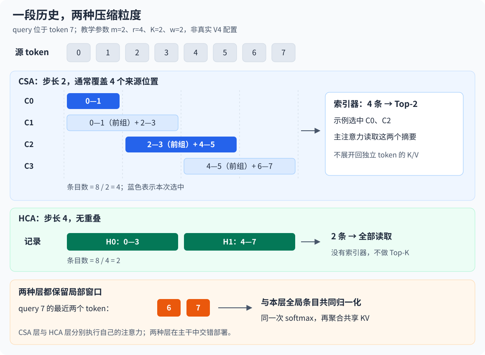

# 注意力机制-5 CSA/HCA

处理百万 token 上下文时，减少每个位置的表示大小、减少每次查询访问的位置，还不能完全解决历史状态持续增长的问题。[MLA](/ai-infra/attention-3-mla)压缩单个位置的 K/V 表示，[DSA](/ai-infra/attention-4-dsa)动态筛选参与主注意力的位置；DeepSeek-V4 进一步沿序列方向聚合信息，让一条历史记录代表多个 token。

V4 将 CSA（Compressed Sparse Attention，压缩稀疏注意力）与 HCA（Heavily Compressed Attention，重压缩注意力）交错部署：前者对适度压缩的历史做动态选择，后者完整读取压缩程度更高的历史，两者都结合 SWA（Sliding-Window Attention，滑动窗口注意力）保留近期细节。本文围绕“生成什么历史状态、何时可见、怎样读取、付出什么代价”展开，范围限于模型注意力设计。

本文以 [V4 技术报告 §2.3](https://arxiv.org/html/2606.19348#S2.SS3)、官方模型配置和参考推理代码为依据，资料核对于 **2026-10-14**。文中的小规模算例用于验证机制，容量计算是明确假设下的估算，不是模型性能实测。

## 00 为什么选少量位置之后，还要压缩历史序列

假设一段代码仓库上下文包含一百万个 token，当前 query 只需要关注其中少量相关位置。DSA 的索引器先给历史位置打分，再把选中的位置交给主注意力，从而减少较昂贵的主注意力计算。

但有两项工作仍随历史增长：过去未被选中的 KV 也要保留，因为未来查询可能需要它；基础索引器仍要在越来越多的位置中寻找候选。于是，“每次读取较少历史”与“历史本身更短”成为两个不同的问题。

| 设计维度 | 代表机制 | 改变的对象 |
|---|---|---|
| 每个位置怎样表示 | MLA | 用潜在向量紧凑表示该位置的多头 K/V |
| 当前查询访问哪里 | DSA | 从历史位置中动态选择一部分 |
| 历史分成多少条记录 | CSA/HCA 的压缩器 | 将连续 token 聚合成更少的历史条目 |

这三个维度可以组合，但组合后得到的是需要训练适配的新注意力模块。把旧模型缓存中相邻向量直接平均，不能自动得到 V4 的能力；压缩投影、聚合权重、查询和后续层都需要共同适应新的表示。

## 01 先区分 token、压缩条目和局部窗口

### 1.1 本文的符号

采用逐 token 的列向量写法，位置从 0 开始编号。下表只保留后文需要的符号；忽略批量与并行切分，以单层、单序列为分析单位。

| 符号 | 含义 |
|---|---|
| $T,t$ | 序列长度、当前 token 位置，$0\le t<T$ |
| $h_j\in\mathbb R^d$ | 第 $j$ 个 token 进入该注意力模块的隐藏向量 |
| $c$ | 主注意力每个 query 头及共享 KV 条目的维度 |
| $H,H_I,d_I$ | 主 query 头数、索引 query 头数、索引头维度 |
| $m,r$ | CSA 的压缩步长、HCA 的压缩步长 |
| $K,w$ | CSA 最多选择的压缩条目数、局部窗口 token 数 |
| $\bar u_s,\bar k_s^I$ | 第 $s$ 条主压缩表示、对应位置的索引压缩 key |

这里的“压缩率”指每前进多少个源 token 产生一条记录。它不等于向量维度缩减比例，也不直接等于字节压缩比例；后者还取决于头数、表示维度、数据精度与辅助状态。

### 1.2 用八个 token 看清两种全局历史

贯穿本文的示例为 token $0,1,\ldots,7$，设置 CSA 的 $m=2$、HCA 的 $r=4$、局部窗口 $w=2$、CSA 的 $K=2$。这些数值便于手算；真实 V4 使用的压缩步长见第 06 节。



CSA 每两个 token 生成一条记录，但除首条外，每条同时聚合当前组与前一组，因此相邻记录有重叠。HCA 每四个 token 生成一条记录，组间不重叠。

| 历史类型 | 条目 | 来源位置 | 最早可见的 query 位置 |
|---|---|---|---|
| CSA | $\bar u_0$ | 0—1 | 1 |
| CSA | $\bar u_1$ | 0—3 | 3 |
| CSA | $\bar u_2$ | 2—5 | 5 |
| CSA | $\bar u_3$ | 4—7 | 7 |
| HCA | $\bar u_0$ | 0—3 | 3 |
| HCA | $\bar u_1$ | 4—7 | 7 |

两种层的压缩条目分别生成，表中的同名条目不表示两层共享张量。在位置 7，CSA 层从四条记录中最多选两条；HCA 层读取两条完整的压缩记录。两种层都额外保留位置 6、7 的局部逐 token 表示。

这个划分已经揭示其分工：全局历史用较少条目延续远处信息，局部窗口提供近期细节。主注意力直接读取压缩条目，不把它们展开回原始 token 的独立 K/V。

## 02 CSA：如何把重叠历史变成可检索条目

### 2.1 先生成内容向量，再生成逐通道聚合权重

CSA 的 Compressor（压缩器）从每个隐藏向量生成两组内容和两组聚合 logits（softmax 前的打分）：

$$
u_j^a=W_u^a h_j,\qquad u_j^b=W_u^b h_j
$$

$$
z_j^a=W_z^a h_j,\qquad z_j^b=W_z^b h_j
$$

四个投影矩阵的维度均为 $c\times d$，输出均为 $c$ 维。上标 $a$ 表示 token 以“当前组成员”参与聚合的分支，$b$ 表示它以“前一组成员”参与下一条记录的分支。它们是不同的可学习投影。

设基础组 $B_s=\{sm,\ldots,(s+1)m-1\}$，并为两种分支分别设置位置偏置 $b^a,b^b\in\mathbb R^{m\times c}$。构造第 $s$ 条记录时，将前一组的 $b$ 分支与当前组的 $a$ 分支组成候选集合：

$$
\mathcal P_s=
\{(j,b):j\in B_{s-1}\}\cup
\{(j,a):j\in B_s\}
$$

对于每个通道 $\ell\in\{1,\ldots,c\}$，沿候选 token 方向做独立 softmax：

$$
\alpha_{s,j,p,\ell}=
\frac{\exp(z^p_{j,\ell}+b^p_{j\bmod m,\ell})}
{\displaystyle\sum_{(v,q)\in\mathcal P_s}
\exp(z^q_{v,\ell}+b^q_{v\bmod m,\ell})}
$$

$$
\widetilde u_{s,\ell}=
\sum_{(j,p)\in\mathcal P_s}
\alpha_{s,j,p,\ell}u^p_{j,\ell}
$$

同一通道的权重和为 1，但不同通道可以关注不同 token。因此，压缩器可以在一个维度侧重标识符，在另一个维度侧重上下文特征，而不必让整个向量使用同一组标量权重。这里的语义分工只是直观解释，具体特征由训练形成，并非人为指定。

首条记录没有前一组：对应内容补零、logits 设为负无穷，使这些位置的权重为零。聚合结果随后经过归一化与位置编码，形成主注意力实际存储的 $\bar u_s$。[论文 §2.3.1](https://arxiv.org/html/2606.19348#S2.SS3.SSS1)与[官方 `Compressor`](https://huggingface.co/deepseek-ai/DeepSeek-V4-Pro/blob/main/inference/model.py)给出了这一结构。

### 2.2 一个条目覆盖两组，为什么记录数仍是 $T/m$

观察示例中的 $\bar u_1$：它聚合前一组 0、1 和当前组 2、3。下一个条目 $\bar u_2$ 聚合 2、3、4、5。窗口宽度是 $2m$，生成步长是 $m$，因此完整条目数为：

$$
N_{\mathrm{CSA}}(T)=\left\lfloor\frac{T}{m}\right\rfloor
$$

不能因为每条记录覆盖 $2m$ 个 token，就把记录数算成 $T/(2m)$。重叠使位于边界附近的信息有机会出现在相邻摘要中；同时，同一 token 在两条记录中经过不同的 $a/b$ 投影，其作用并不相同。

重叠也改变了 Top-K 的解释。选择 $K$ 条记录不表示读取了 $K$ 个原始 token，也不能精确换算成 $mK$ 个原始 token。它们最多涉及 $2mK$ 个来源位置，再因相邻条目重叠而减少；更关键的是，读到的是这些来源的聚合表示。

### 2.3 一个可以手算的逐通道池化

令 $m=2,c=2$，计算 $\bar u_1$ 的池化前身 $\widetilde u_1$。假设内容投影与门控打分产生以下值：

| 来源 | 内容向量 | 通道 1 权重 | 通道 2 权重 |
|---|---|---|---|
| token 0，前一组 $b$ 分支 | $(1,10)$ | $1/8$ | $4/8$ |
| token 1，前一组 $b$ 分支 | $(3,30)$ | $1/8$ | $2/8$ |
| token 2，当前组 $a$ 分支 | $(5,50)$ | $2/8$ | $1/8$ |
| token 3，当前组 $a$ 分支 | $(7,70)$ | $4/8$ | $1/8$ |

这些权重可由各通道的 logits 分别取 $\log(1,1,2,4)$ 与 $\log(4,2,1,1)$ 得到。于是：

$$
\widetilde u_1=
\left(
\frac{1+3+2\cdot5+4\cdot7}{8},
\frac{4\cdot10+2\cdot30+50+70}{8}
\right)=(5.25,27.5)
$$

这个结果位于归一化与位置编码之前。它说明两个维度可以采用不同的时间聚合方式；如果误写成“每个 token 一个权重，再对整个向量平均”，就改变了压缩器的表达能力。

### 2.4 条目只能在来源完整后进入候选集合

采用官方参考代码的完成时刻约定，当前位置 $t$ 能看到的完整 CSA 条目数为：

$$
n_m(t)=\left\lfloor\frac{t+1}{m}\right\rfloor,\qquad
0\le s<n_m(t)
$$

例如，query 位于 token 2 时，$\bar u_1$ 还依赖未来的 token 3，只能使用 $\bar u_0$；query 位于 token 3 时，$\bar u_1$ 刚好完整，可以加入候选。该时序也允许当前 token 参与自身的注意力。

prefill（提示序列的并行前向计算）即使一次处理整段输入，也必须逐 query 遮蔽尚未完成的条目。decode（逐 token 生成）则暂存当前组的投影与 logits，组结束时生成新记录；CSA 还保留前一组所需状态。局部窗口让尚未形成全局记录的近期 token 仍可参与注意力。

实现核对可看参考代码中的 `should_compress`、`get_compress_topk_idxs` 与 `Indexer.forward` 的掩码。技术报告以“先前压缩块”概述因果约束；本文涉及块末尾的具体开放时刻，以参考代码的完成判定和掩码为准。判断因果性最终要落实到“组成该条目的最后一个 token 是否已经可见”。

## 03 从压缩历史中选择：索引器在筛选什么

### 3.1 主压缩表示与索引 key 分开生成

CSA 保留 Lightning Indexer（轻量索引器）的基本思想，但候选对象从逐 token 历史变成压缩条目。索引器具有自己的压缩器，将同一组隐藏状态聚合成 $\bar k_s^I\in\mathbb R^{d_I}$；主注意力的压缩器生成 $\bar u_s\in\mathbb R^c$。

两套压缩器具有对齐的条目编号和来源区间，参数与表示空间独立。不能将 V4 CSA 描述为“先生成一份主 KV，再简单投影成索引 key”；后续 CSA2 对状态来源与共享关系的调整，将留到下一篇。

当前 token 先经低秩 query 投影得到中间向量 $c_t^Q\in\mathbb R^{d_Q}$，主 query 和索引 query 再从它展开：

$$
c_t^Q=\operatorname{RMSNorm}(W^{DQ}h_t),\qquad
q^{\mathrm{raw}}_{t,i}=W^{UQ}_i c_t^Q,\qquad
q^{I,\mathrm{raw}}_{t,a}=W^{IQ}_a c_t^Q
$$

其中 $W^{DQ}\in\mathbb R^{d_Q\times d}$，$W_i^{UQ}\in\mathbb R^{c\times d_Q}$，$W_a^{IQ}\in\mathbb R^{d_I\times d_Q}$。RMSNorm（Root Mean Square Normalization，均方根归一化）按向量均方根缩放，再应用可学习缩放参数。它控制表示尺度，不改变条目数。

### 3.2 Top-K 选中的是压缩条目的地址

用完成位置编码等处理后的索引 query、key 表示索引打分，可以写为：

$$
I_{t,s}=\sum_{a=1}^{H_I}\omega_{t,a}
\operatorname{ReLU}\left((q^I_{t,a})^\top\bar k_s^I\right)
$$

其中 $\operatorname{ReLU}(x)=\max(x,0)$，$\omega_{t,a}$ 是从当前隐藏状态投影得到的头权重，缩放因子并入其中。对可见条目取：

$$
\mathcal S_t=\operatorname{TopK}_{\,0\le s<n_m(t)} I_{t,s},\qquad
|\mathcal S_t|=\min(K,n_m(t))
$$

这些地址让主注意力读取对应的 $\bar u_s$。各主 query 头共享这组选中条目，但会计算各自的主注意力分数。索引打分是筛选依据，主注意力仍会重新计算 query 与主 KV 的匹配。

在八 token 示例中，假设 query 7 选中 $\mathcal S_7=\{0,2\}$，主全局路径读取 $\bar u_0$ 和 $\bar u_2$。它不会回到来源位置 0—5 展开计算完整 token 注意力。这个区别决定了 CSA 同时承担“压缩造成的信息合并”与“选择造成的候选遗漏”两种近似。

上述数据流可对照[官方 `Indexer` 与 `Attention`](https://huggingface.co/deepseek-ai/DeepSeek-V4-Pro/blob/main/inference/model.py)。它延续了 DSA 的选择思想，但查询的候选空间已经改变。

## 04 HCA：压得更重，然后读取全部压缩历史

### 4.1 非重叠的门控聚合

HCA 不使用索引器。它从每个 $h_j$ 生成一份内容 $u_j=W_u h_j\in\mathbb R^c$ 和一份 logits $z_j=W_z h_j\in\mathbb R^c$，每 $r$ 个 token 聚合一条记录。

设第 $s$ 组为 $D_s=\{sr,\ldots,(s+1)r-1\}$，位置偏置 $b\in\mathbb R^{r\times c}$，则：

$$
\gamma_{s,j,\ell}=
\frac{\exp(z_{j,\ell}+b_{j\bmod r,\ell})}
{\displaystyle\sum_{v\in D_s}\exp(z_{v,\ell}+b_{v\bmod r,\ell})},\qquad
\widetilde u_{s,\ell}=\sum_{j\in D_s}\gamma_{s,j,\ell}u_{j,\ell}
$$

它仍是逐通道的可学习池化，但没有 CSA 的两套重叠分支。池化后同样进行归一化与位置编码，形成 $\bar u_s$。[论文 §2.3.2](https://arxiv.org/html/2606.19348#S2.SS3.SSS2)定义了 HCA。

在位置 $t$，HCA 读取全部 $\lfloor(t+1)/r\rfloor$ 条已完成记录。因此，它的“完整访问”指完整的压缩历史；原始 token 已在写入阶段合并。

### 4.2 两种层交换的是信息粒度与选择成本

CSA 保留较细的历史条目，再付出索引开销选择其中一部分；HCA 将历史聚合得更粗，省去选择过程，让每条完整记录都能参与匹配。

| 对比项 | CSA | HCA |
|---|---|---|
| 全局记录生成 | 两组重叠、逐通道聚合 | 单组非重叠、逐通道聚合 |
| 完整记录数 | $\lfloor T/m\rfloor$ | $\lfloor T/r\rfloor$ |
| 全局主注意力 | 最多读取 $K$ 条 | 读取所有可见压缩条目 |
| 辅助索引状态 | 有独立的压缩索引 key | 无索引器 |
| 主要表达代价 | 聚合损失，以及选择时可能遗漏 | 更粗聚合造成的细节损失 |

交错部署让不同层在不同粒度上处理全局信息。仅凭“某层保留了全部摘要”，不能证明任意原始细节仍可精确检索；摘要中的信息保留能力需要通过训练和长上下文评测建立。

## 05 主注意力：局部 token 与全局条目怎样一起读

### 5.1 多个 query 头共享一份历史向量

两种层的核心采用 MQA（Multi-Query Attention，多查询注意力）式共享：有多个 query 头，历史条目只有一个共享 KV 头。V4 进一步让同一条向量同时充当 key 与 value。

局部窗口使用独立投影生成逐 token 的共享向量 $u_j^{\mathrm{local}}=W_{\mathrm{local}}h_j$，并应用归一化与位置编码；全局路径使用对应压缩器生成的条目。二者的表示维度均为 $c$，来源和投影参数不同。

设 $\mathcal A_t$ 是当前可访问条目的集合：CSA 取局部窗口与 $\mathcal S_t$，HCA 取局部窗口与全部可见压缩记录。集合中的标签区分“局部位置”与“全局记录”，每个条目的存储向量记为 $x_a\in\mathbb R^c$。第 $i$ 个主 query 头对它打分：

$$
\ell_{t,i,a}=\frac{q_{t,i}^{\top}x_a}{\sqrt c}
$$

这里的 $x_a$ 同时用于后面的 value 聚合。它与普通 MQA“共享一份 K、另外共享一份 V”还存在差别，也不能直接套用 V3 MLA 中各头 K/V 展开与矩阵吸收的整套解释。

### 5.2 两路条目进入同一次 softmax

V4 为每个头引入可学习的 attention sink logit（注意力汇聚槽打分）$\beta_i$。它只向归一化分母贡献一项，可以视为 value 为零的额外候选：

$$
p_{t,i,a}=
\frac{\exp(\ell_{t,i,a})}
{\exp(\beta_i)+\displaystyle\sum_{b\in\mathcal A_t}\exp(\ell_{t,i,b})},\qquad
\widehat o_{t,i}=\sum_{a\in\mathcal A_t}p_{t,i,a}x_a
$$

因而真实条目上的权重和可以小于 1，头不必把全部权重分配给现有历史。这一项是可学习标量，不等于必须常驻缓存的首 token。

局部和全局条目在同一个分母中竞争。分别给两路算 softmax，再直接相加两个输出，会改变归一化与输出尺度，不是上述注意力。参考代码将两路地址拼接后调用同一次主注意力；[论文 §2.3.3](https://arxiv.org/html/2606.19348#S2.SS3.SSS3)描述了这些共同细节。

一个压缩条目可能包含窗口内 token 的信息，但它与窗口中的逐 token 表示是不同的候选。不能因为来源重叠就将摘要中的那部分“扣掉”，也不要求按原始 token 自动去重。

### 5.3 位置编码为什么还需要反向旋转

V4 使用 partial RoPE（Partial Rotary Positional Embedding，部分旋转位置编码）：主 query 与共享 KV 的最后 64 维做位置旋转，其余维度保持非旋转形式。主 query 按头进行均方根归一化，参考代码的这一步不带可学习缩放；query 中间向量与共享 KV 则使用带可学习缩放的 RMSNorm。归一化之后再施加旋转。

为了区分位置与可见性，令 $\rho(a)$ 为条目的位置锚点，$R_{\rho(a)}$ 为只旋转末尾维度的矩阵。局部条目的锚点是原 token 位置；参考压缩器为第 $s$ 个全局条目使用当前基础组的起点 $sm$ 或 $sr$。

**起点用于位置编码，终点决定何时可见。** 例如 CSA 示例的 $\bar u_1$ 使用位置锚点 2，却要等到 token 3 才完整；它覆盖的来源还包括位置 0、1。这是给聚合条目指定代表位置，不是保留每个来源 token 的独立相对位置。

由于同一 $x_a$ 同时充当 K 与 V，value 聚合时也包含旋转后的分量。V4 在输出投影前，对各头输出的末尾旋转维度应用当前 query 位置的逆旋转：

$$
o_{t,i}=R_t^{-1}\widehat o_{t,i}
=\sum_{a\in\mathcal A_t}p_{t,i,a}R_t^{-1}R_{\rho(a)}u_a
$$

这里 $u_a$ 表示归一化后、旋转前的条目。逆旋转把输出的旋转子空间转到当前 query 的参照系，不能将其解释成“value 从未旋转”。索引器还有自身的低精度数值处理路径；上述公式聚焦主注意力的位置关系。

### 5.4 分组输出投影在压缩哪一部分

将 $H$ 个头的输出拼接后，向量维度为 $Hc$。V4 不直接使用一张 $d\times Hc$ 的完整输出矩阵，而是先均分为 $g$ 组，每组独立降维到 $d_g$，再统一投影回隐藏维度：

$$
y_t=W^B\operatorname{Concat}_{v=1}^{g}
\left(W^A_v o_t^{(v)}\right)
$$

其中 $o_t^{(v)}\in\mathbb R^{Hc/g}$，$W_v^A\in\mathbb R^{d_g\times Hc/g}$，$W^B\in\mathbb R^{d\times gd_g}$。分组的是输出映射；它不表示有 $g$ 个 KV 头，也不表示每组选择不同历史。

以 Flash 的 $H=64,c=512,d=4096,g=8,d_g=1024$ 为例，忽略偏置：完整输出矩阵有 $134{,}217{,}728$ 个参数；分组后的两阶段分别有 $33{,}554{,}432$ 个参数，总计 $67{,}108{,}864$。该输出投影的参数量减半，不等于整个注意力模块、模型参数或运行时间减半。

## 06 对照 V4-Flash 与 V4-Pro 的实际配置

以下数值来自官方 [Flash 配置](https://huggingface.co/deepseek-ai/DeepSeek-V4-Flash/blob/main/config.json)、[Pro 配置](https://huggingface.co/deepseek-ai/DeepSeek-V4-Pro/blob/main/config.json)与 [Pro 参考推理配置](https://huggingface.co/deepseek-ai/DeepSeek-V4-Pro/blob/main/inference/config.json)，解释对象为 V4，不能自动推广到后续 V4.1。

| 配置 | V4-Flash | V4-Pro |
|---|---:|---:|
| 主干层数 | 43 | 61 |
| 隐藏维度 $d$ | 4096 | 7168 |
| 主 query 头数 $H$ | 64 | 128 |
| 共享 KV 头数 | 1 | 1 |
| 主头维度 $c$ | 512 | 512 |
| query 中间维度 $d_Q$ | 1024 | 1536 |
| CSA 压缩步长 $m$ | 4 | 4 |
| CSA Top-K | 512 | 1024 |
| 索引头数 $H_I$ / 维度 $d_I$ | 64 / 128 | 64 / 128 |
| HCA 压缩步长 $r$ | 128 | 128 |
| 局部窗口 $w$ | 128 | 128 |
| 输出分组数 $g$ / 组内中间维度 $d_g$ | 8 / 1024 | 16 / 1024 |
| 主干层型数量 | 2 个纯 SWA、21 个 CSA、20 个 HCA | 30 个 CSA、31 个 HCA |

`compress_ratios` 的 `0` 表示该层只有局部窗口，`4` 表示 CSA，`128` 表示 HCA。Flash 前两层是纯 SWA，随后交替安排 CSA/HCA；Pro 前两层是 HCA，随后交替安排 CSA/HCA。

配置数组末尾还包含 MTP（Multi-Token Prediction，多 token 预测）模块的记录，所以数组长度分别为 44、62。统计主干注意力层必须以 `num_hidden_layers` 的 43、61 为界，不能把末尾 `0` 再计为一个主干纯 SWA 层。

真实 V4 的 CSA 每条记录覆盖相邻两组，即最多 8 个源 token，但每 4 个 token 输出一条。参考实现以 `compress_ratio == 4` 启用重叠分支；本文的 $m=2$ 是对同一算法结构的教学缩小，并不是把官方类的参数改成 2 就能得到该示例。

## 07 量化收益：缓存条目、读取条目与计算量分开算

### 7.1 固定 Top-K 没有固定全局缓存大小

暂时忽略精度差异，以元素数估算单层持久历史状态。CSA 需要保存主压缩条目和独立索引 key，HCA 只需要主压缩条目；两者还要保存局部窗口：

$$
M_{\mathrm{CSA}}^{\mathrm{elem}}\approx
\frac{T}{m}(c+d_I)+wc,\qquad
M_{\mathrm{HCA}}^{\mathrm{elem}}\approx
\frac{T}{r}c+wc
$$

这些表达式省略取整、压缩器的有界工作状态、元数据与对齐，不包含模型权重和临时激活。虽然 CSA 每次最多选择 $K$ 条，全局记录仍要保留，因为未来查询会选择不同位置。

设 $T=2^{20}=1{,}048{,}576$，采用 Flash 的参数。先做一个便于比较的假设：所有历史向量元素均以 BF16（BFloat16，16 位浮点格式）存储，每元素 2 字节，$1\ \mathrm{MiB}=2^{20}$ 字节。

| 单层逻辑状态 | CSA | HCA |
|---|---:|---:|
| 主全局记录数 | 262,144 | 8,192 |
| 主全局表示容量 | 256 MiB | 8 MiB |
| 独立索引 key 容量 | 64 MiB | 无 |
| 局部窗口表示容量 | 0.125 MiB | 0.125 MiB |
| 以上合计 | 320.125 MiB | 8.125 MiB |

表格是统一精度下的逻辑容量，不能当作 V4 的实际显存占用。V4 主 KV 的非旋转部分采用 FP8（8 位浮点），旋转部分保留 BF16，索引计算采用 FP4（4 位浮点）相关处理，还需考虑缩放因子等开销；参考实现中某些低精度操作用量化后回写的模拟路径，也不能只看张量声明就认定真实部署的持久布局。

### 7.2 HCA 没有索引器，也可能读取更多主条目

在同样长度的末尾 query，Flash 的 CSA 最多读取 $512+128=640$ 条主注意力记录；HCA 读取 $8192+128=8320$ 条。HCA 的全局缓存更小，并不意味着它的主注意力每次读取更少。

CSA 在这里还要让索引器对 262,144 条较低维索引 key 打分。不能将 640 当作这个 query 所有注意力相关计算的候选规模。两种层节约成本的方式不同，取舍取决于主注意力、索引器、投影和数值精度的共同开销。

### 7.3 主注意力变稀疏后，整体是否已经线性

记 $A=Hc$、$J=H_I d_I$，分别概括主注意力与索引打分的维度成本。仅统计随历史长度增长的匹配与加权聚合，忽略固定维度投影、压缩器、Top-K 选择本身及实现常数：

| 路径 | 历史长度约为 $T$ 时，单个 query 的量级 | 长度 $T$ 的因果 prefill 总量级 |
|---|---|---|
| CSA 主注意力 | $O(A(K+w))$ | $O(TA(K+w))$ |
| CSA 索引打分 | $O(JT/m)$ | $O(JT^2/m)$ |
| HCA 主注意力 | $O(A(T/r+w))$ | $O(A(T^2/r+Tw))$ |

CSA 主注意力的写法取候选足够多时的上界，较短前缀实际读取 $\min(K,n_m(t))$ 条。索引器打分总量来自逐 query 累加：

$$
\sum_{t=0}^{T-1}\left\lfloor\frac{t+1}{m}\right\rfloor
=\Theta(T^2/m)
$$

当 $m,r$ 是固定常数，CSA 的全范围索引与 HCA 的全压缩历史注意力仍保留二次增长项。压缩显著减小系数，CSA 的主注意力部分可以随 $T$ 线性增长，但这不能推导成整个模块严格线性。

同样，新增 token 的压缩工作不需要重算整段历史，只需更新有界分组状态；这有利于逐步写入，却不消除读历史时的长度依赖。上述分析描述算法规模，不替代真实时间测量。

## 08 用最小程序验证池化与因果边界

以下 Python 3 示例只依赖标准库，重现第 2.3 节的通道权重和第 2.4 节的可见记录数。它省略可学习投影、归一化、位置编码、索引打分与低精度处理，用于验证两个局部判断，不是完整 V4 实现。

```python
from math import exp, isclose, log


def channel_pool(values, logits):
    # values/logits: [源位置数, 通道数]
    channels = len(values[0])
    result = []
    for c in range(channels):
        peak = max(row[c] for row in logits)
        weights = [exp(row[c] - peak) for row in logits]
        denominator = sum(weights)
        result.append(sum(v[c] * w for v, w in zip(values, weights))
                      / denominator)
    return result


values = [[1, 10], [3, 30], [5, 50], [7, 70]]
logits = [[log(a), log(b)] for a, b in [(1, 4), (1, 2), (2, 1), (4, 1)]]
pooled = channel_pool(values, logits)
assert all(isclose(a, b) for a, b in zip(pooled, [5.25, 27.5]))


def visible_entries(t, stride):
    return list(range((t + 1) // stride))


assert visible_entries(2, 2) == [0]
assert visible_entries(3, 2) == [0, 1]
assert visible_entries(7, 2) == [0, 1, 2, 3]
assert visible_entries(7, 4) == [0, 1]
print(pooled)  # [5.25, 27.5]
```

继续阅读官方实现时，可以按数据流检查三个入口：`Compressor.forward` 负责投影、门控池化、完成时刻和条目写入；`Indexer.forward` 负责独立索引历史、因果掩码与 Top-K；`Attention.forward` 负责局部/全局地址组合、共享 KV 主注意力、逆旋转与分组输出。

更完整的模型验证需要比较逐 token 执行与整段执行的输出，确认未来 token 不影响过去 query，再评测跨组边界检索、多证据聚合与长距离精确复制。局部算例成立，只能证明对应公式和边界计算一致，不能据此证明压缩后的模型质量或速度。

## 09 压缩带来的能力边界与后续方向

### 9.1 压缩发生在未来 query 到来之前

全局条目生成后会被许多未来 query 复用，因此门控池化依赖组内隐藏状态与位置偏置，不依赖尚未出现的查询。主注意力可以根据未来 query 选择和读取摘要，却无法重新决定已经丢失的逐 token 细节。

原始注意力中，同一组 token 的聚合权重可以随 query 改变；预先压成一条记录后，未来查询的每个头只能给整条记录分配一个主注意力权重。逐通道门控和重叠增加了保留信息的灵活性，但不构成对任意 query 的无损等价证明。

这也解释了局部窗口的价值：近期代码符号、邻接依赖和尚未完成的组，仍有逐 token 表示可读。窗口会继续滑动，远处信息最终依赖压缩表示；它不能保证所有远处细节都能恢复。

### 9.2 这项改变需要模型结构与权重共同支持

使用 CSA/HCA，需要实现对应压缩器、共享 KV 主注意力、局部窗口、位置处理与层型安排，并使用为这些结构训练的权重。修改配置里的 Top-K 只能在已经支持该字段与执行路径的模型上改变选择规模；它不能让 DSA 模型自动获得可学习序列压缩器。

同样，CSA 的索引器与主注意力仍有各自的表示和成本，改变一个参数不能替代对实际模块的检查。这延续了上一篇的判断方法：先确认配置映射到什么结构，再讨论计算和质量变化。

### 9.3 从层内压缩，走向跨层共享

到 V4 为止，DeepSeek 主线已经依次处理了单个位置的表示成本、当前查询的选择范围，以及历史序列的记录粒度。CSA 用适度压缩和动态选择保留较细的可检索历史，HCA 用更粗的全局表示省去索引器，局部窗口为两者提供近期细节。

下一篇将讨论 **CSA2**：当一个层已经生成了全局主 KV、索引 key 和选中位置，相邻层分别能复用哪些状态，哪些查询与选择仍需重新计算。这将把“每层内部如何读历史”推进到“多层之间如何组织同一段历史”。

继续阅读：[注意力机制-6 CSA2](/ai-infra/attention-6-csa2)。

## 参考资料

以下资料查阅于 2026-10-14。Hugging Face 的 `main` 是滚动分支；复现实验还应固定下载的模型 revision 与实现版本。

1. DeepSeek-AI，[DeepSeek-V4: Towards Highly Efficient Million-Token Context Intelligence](https://arxiv.org/abs/2606.19348)。重点见 §2.3 的 CSA/HCA、共同细节与效率讨论，以及 §4.2.1 的模型配置。
2. DeepSeek-AI，[V4-Pro 官方参考模型实现](https://huggingface.co/deepseek-ai/DeepSeek-V4-Pro/blob/main/inference/model.py)。重点见 `Compressor`、`Indexer`、`Attention` 和压缩条目因果掩码。
3. DeepSeek-AI，[V4-Flash 模型配置](https://huggingface.co/deepseek-ai/DeepSeek-V4-Flash/blob/main/config.json)、[V4-Pro 模型配置](https://huggingface.co/deepseek-ai/DeepSeek-V4-Pro/blob/main/config.json)及[参考推理配置](https://huggingface.co/deepseek-ai/DeepSeek-V4-Pro/blob/main/inference/config.json)。用于核对维度、压缩率和层型，注意区分主干与 MTP。
4. Hugging Face，[Transformers DeepSeek-V4 文档](https://huggingface.co/docs/transformers/main/en/model_doc/deepseek_v4)。用于对照 CSA/HCA 与混合注意力的接口术语；`main` 文档不代表所有已安装版本都支持该模型。
